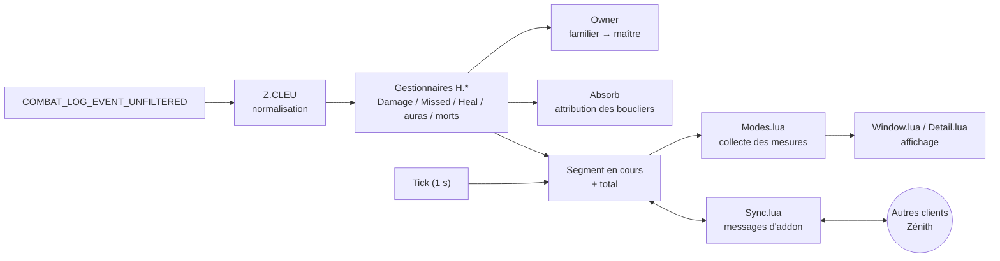
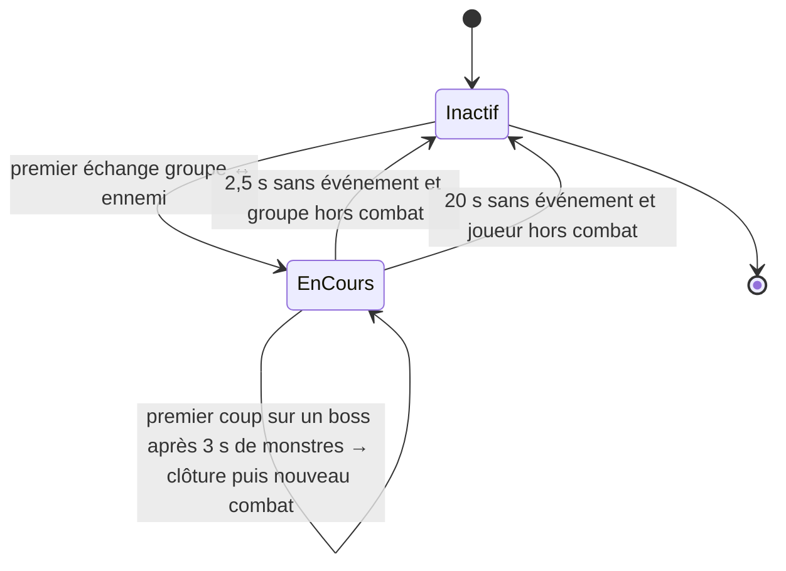
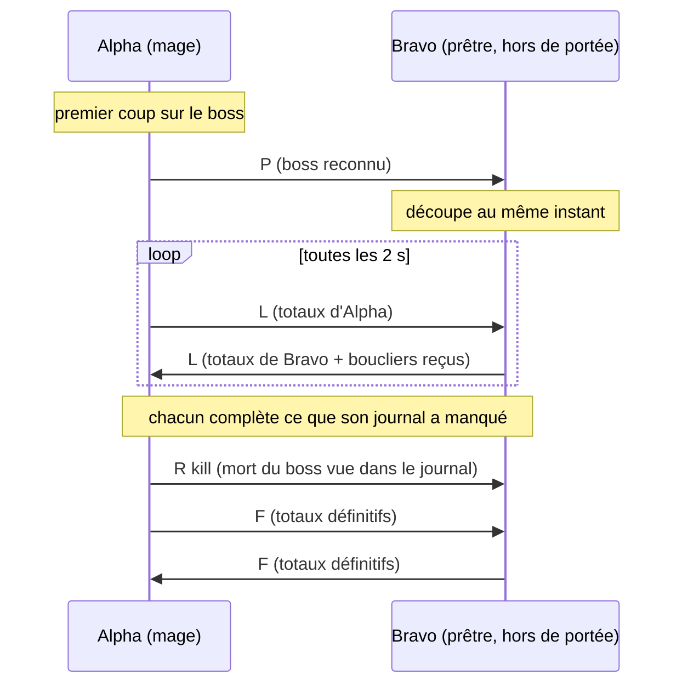

# Construction de Zénith

Ce document décrit comment Zénith est construit : ses objectifs, son architecture, les algorithmes de chaque module et les raisons des choix faits. Il s'adresse à qui veut comprendre le code, le vérifier ou y contribuer.

Version décrite : **1.10.4**.

## Sommaire

1. [Objectifs et contraintes](#1-objectifs-et-contraintes)
2. [Vue d'ensemble](#2-vue-densemble)
3. [Amorçage et noyau](#3-amorçage-et-noyau)
4. [Groupe et familiers](#4-groupe-et-familiers)
5. [Lecture du journal de combat](#5-lecture-du-journal-de-combat)
6. [Cycle de vie d'un combat](#6-cycle-de-vie-dun-combat)
7. [Reconnaissance des boss](#7-reconnaissance-des-boss)
8. [Attribution des absorptions](#8-attribution-des-absorptions)
9. [Morts, auras et temps d'activité](#9-morts-auras-et-temps-dactivité)
10. [Spécialisation et rôle](#10-spécialisation-et-rôle)
11. [Synchronisation de groupe](#11-synchronisation-de-groupe)
12. [Fiabilité des données](#12-fiabilité-des-données)
13. [Mesures et analyse](#13-mesures-et-analyse)
14. [Interface](#14-interface)
15. [Données sauvegardées](#15-données-sauvegardées)
16. [Performances](#16-performances)
17. [Vérification](#17-vérification)
18. [Limites connues](#18-limites-connues)
19. [Contribuer](#contribuer)

---

## 1. Objectifs et contraintes

**Objectifs**
- Mesurer précisément un combat : dégâts, soins, absorptions, dégâts subis, morts, auras.
- **Afficher les mêmes chiffres chez tous les joueurs du groupe**, ce que les compteurs de la 3.3.5 ne font pas.
- Rester compréhensible pour un débutant : interface en français, explication de chaque mesure, analyse en phrases simples.

**Contraintes**
- **Client 3.3.5a** (Interface `30300`). Une partie de l'API moderne n'existe pas encore :
  - pas de `C_Timer` (Zénith a ses propres minuteries) ;
  - pas d'`ENCOUNTER_START` / `ENCOUNTER_END` (Zénith reconnaît les boss lui-même) ;
  - pas de `RegisterAddonMessagePrefix`, apparu en 4.1 (les préfixes d'addon sont libres).
- **Lua 5.1**, la version embarquée par le client.
- **Aucune bibliothèque requise.** LibBossIDs, LibGroupTalents et DBM sont mis à profit s'ils sont déjà chargés par un autre addon, mais aucune n'est embarquée ni nécessaire.
- **Le journal de combat 3.3.5 a des manques**, que Zénith doit compenser :
  - il ne dit pas quel bouclier a absorbé un coup ;
  - sa portée est limitée ;
  - il lui arrive de cesser d'émettre des événements (bogue connu du client).

---

## 2. Vue d'ensemble



**Fichiers**, dans l'ordre de chargement de `Zenith.toc` :

| Fichier | Lignes | Rôle |
|---|---:|---|
| `Core.lua` | ~370 | espace de noms, réglages, minuteries, bus de messages, événements, commandes |
| `Bosses.lua` | ~110 | liste des boss, rencontres à plusieurs créatures, `Z.CreatureId` |
| `Spec.lua` | ~275 | spécialisation et rôle des joueurs |
| `Combat.lua` | ~2 250 | cœur : journal de combat, segments, boucliers, morts, boss, fusion de la synchronisation |
| `Sync.lua` | ~150 | transport de la synchronisation de groupe |
| `Modes.lua` | ~725 | les 26 mesures, collecte, infobulles, analyse |
| `UI.lua` | ~685 | composants d'interface |
| `Window.lua` | ~985 | fenêtres, relecture, rapport, résumé de fin de combat |
| `Detail.lua` | ~710 | fiche détaillée d'un joueur |
| `Options.lua` | ~475 | panneau d'options |

Les modules communiquent par un **bus de messages interne** (`Z:On` / `Z:Fire`) plutôt que par appels directs. La collecte des données ignore tout de l'affichage, et l'affichage se contente de réagir :

| Message | Émis par | Écouté par |
|---|---|---|
| `COMBAT_START` / `COMBAT_END` | `Combat.lua` | fenêtres, résumé, synchronisation |
| `BOSS`, `DEATH` | `Combat.lua` | (points d'extension) |
| `PULL`, `ENCOUNTER_RESULT` | `Combat.lua` | `Sync.lua` (relais au groupe) |
| `SYNC` | `Combat.lua` | fenêtres, fiche détaillée |
| `SPEC` | `Spec.lua` | fenêtres |
| `SETTINGS`, `RESET` | options, commandes | tous les modules d'affichage |

---

## 3. Amorçage et noyau

`Core.lua` crée l'objet central `Z`. C'est un `Frame` sans parent, pour que ses minuteries continuent de tourner quand l'interface est masquée (Alt+Z).

**Séquence de démarrage**

1. **`ADDON_LOADED`** :
   - charge `ZenithDB` (réglages, communs à tous les personnages) et `ZenithCharDB` (données, par personnage) ;
   - complète les réglages manquants à partir des valeurs par défaut ;
   - réinitialise les données si leur numéro de schéma (`Z.SCHEMA`) a changé ;
   - nettoie les segments sauvegardés de leurs champs de session (heures `GetTime()`, invalides après une reconnexion).
2. **`PLAYER_LOGIN`** :
   - vérifie que **chaque fichier a bien été lu** ;
   - initialise ensuite les modules : combat, synchronisation, spécialisations, fenêtres, mini-carte, résumé.

La vérification de l'étape 2 répond à un piège du client 3.3.5 : il ne lit que les fichiers présents à son lancement. Un addon mis à jour pendant que le jeu tourne peut donc perdre un fichier, même après `/reload`. Plutôt qu'une cascade d'erreurs, Zénith signale le problème et reste inactif.

**Minuteries** : `Z:After(délai, fn)` et `Z:Every(intervalle, fn)`, pilotées par un unique `OnUpdate`. Chaque appel est protégé : une erreur est transmise au gestionnaire d'erreurs du jeu sans arrêter les autres minuteries.

**Événements** : un unique `OnEvent` appelle la méthode du même nom sur `Z` (`Z:PLAYER_ENTERING_WORLD()`…). `COMBAT_LOG_EVENT_UNFILTERED`, de loin le plus fréquent, est envoyé directement à `Z.CLEU` sans recherche.

---

## 4. Groupe et familiers

**Effectif** (`Z:UpdateRoster`), sur `RAID_ROSTER_UPDATE`, `PARTY_MEMBERS_CHANGED`, `UNIT_PET` et les entrées/sorties de véhicule :
- `roster[guid] = { name, class, unit }` pour chaque membre ;
- `byName[nom] = guid`, index utilisé par la synchronisation ;
- `pets[guid du familier] = guid du maître`.

Les données de session d'un joueur qui quitte le groupe (journal des morts, capacités de boucliers apprises, spécialisation) sont libérées.

**Rattachement d'une source à son maître** (`Owner`), dans cet ordre :
1. un joueur est son propre maître ;
2. la table des familiers, en remontant jusqu'à 3 niveaux (un élémentaire invoqué par un totem remonte au chaman) ;
3. le drapeau « à moi » du journal : la source appartient au joueur local ;
4. une relecture de l'effectif, au plus une fois toutes les 2 s : le familier a pu être invoqué hors de portée ;
5. en dernier recours, l'infobulle de l'unité (« Familier de X »), comparée aux noms du groupe.

Un échec est mémorisé 5 s pour ne pas relancer ces recherches à chaque coup. Les coups d'un familier dont le maître reste inconnu ne sont pas comptés et sont signalés dans le bilan de fiabilité. Au-delà de 600 familiers connus, la table est vidée et reconstruite.

---

## 5. Lecture du journal de combat

`Z.CLEU` reçoit chaque événement avec la signature 3.3.5 : horodatage, type, puis source et cible (GUID, nom, drapeaux), puis les champs propres au type. Pour chaque événement, il :
1. lit l'heure une seule fois (`NOW`), réutilisée par tous les traitements ;
2. normalise les drapeaux : une unité sans GUID ne peut pas être membre du groupe (certains serveurs émettent des événements mal formés) ;
3. appelle le gestionnaire du type dans la table `H`, ou rien si le type n'est pas suivi.

| Événements | Gestionnaire | Effet |
|---|---|---|
| `SWING_DAMAGE`, `SPELL_DAMAGE`, `SPELL_PERIODIC_DAMAGE`, `RANGE_DAMAGE`, `DAMAGE_SHIELD`, `DAMAGE_SPLIT`, `SPELL_BUILDING_DAMAGE`, `ENVIRONMENTAL_DAMAGE` | `Damage` | dégâts infligés et subis, absorptions, ennemis, boss |
| `SWING_MISSED`, `SPELL_MISSED`, `SPELL_PERIODIC_MISSED`, `RANGE_MISSED`, `DAMAGE_SHIELD_MISSED` | `Missed` | ratés, esquives, parades, blocages, absorptions totales, renvois |
| `SPELL_HEAL`, `SPELL_PERIODIC_HEAL` | `Heal` | soins, excès, soins reçus |
| `SPELL_AURA_APPLIED` / `REFRESH` / `REMOVED` | boucliers, auras | suivi des boucliers, temps d'effet, postures de tank |
| `SPELL_SUMMON`, `SPELL_CREATE`, `UNIT_DESTROYED` | familiers | table des familiers |
| `SPELL_INTERRUPT`, `SPELL_DISPEL`, `SPELL_STOLEN`, `SPELL_RESURRECT`, `PARTY_KILL` | `Count` | compteurs et leur détail |
| `UNIT_DIED` | morts | morts du groupe, mort des boss |
| `SPELL_CAST_SUCCESS` | spécialisation | sorts signatures, changement de spécialisation |

**Règles d'attribution des dégâts**
- Seuls comptent les échanges où le groupe est source ou cible. Les dégâts d'un joueur sur lui-même ou sur son familier ne sont ni des dégâts ni des tirs amis.
- Les dégâts d'un membre du groupe sur un autre sont comptés à part, comme dégâts infligés aux alliés.
- L'excédent du coup fatal (*overkill*) est inclus dans le total, comme le fait le jeu, et suivi séparément dans la fiche du sort.
- **Sort renvoyé** (Renvoi de sort) : le journal montre l'ennemi se blesser lui-même. Le renvoi est mémorisé 5 s et les dégâts sont crédités au joueur qui a renvoyé le sort.
- **Marque de sang** : le journal désigne l'ennemi marqué comme soigneur. Le soin est crédité au chevalier de la mort qui a posé la marque.
- **Sorts découpés en deux identifiants** (Frappe-tempête, Mutilation main gauche) : ils sont fusionnés en une seule ligne.
- **Fiches de sorts** : clé `id`, `id + 1e7` si le sort vient d'un familier, `id + 2e7` pour une absorption, valeur négative pour un effet périodique. La clé `3e7` est réservée à la ligne « Hors de portée (synchronisé) ».

Chaque donnée est écrite deux fois : dans le **segment en cours** et dans le **total**.

---

## 6. Cycle de vie d'un combat



**Ouverture** (`Start`) : au premier échange entre le groupe et un ennemi, qu'il s'agisse d'un coup, d'un raté, d'une parade ou d'une absorption. Un simple tic de DoT sur un joueur, ou un dégât de l'environnement, ne suffit pas. À l'ouverture, Zénith :
- mémorise qui a engagé, avec quel sort et sur quelle cible ;
- relève les auras déjà portées par le groupe ;
- reprend un boss annoncé juste avant (par DBM ou un coéquipier).

**Trois heures par segment**, toutes en `GetTime()` et valables pour la session seulement :
- `start` : l'origine de la chronologie (tranches de 3 s), fixe ;
- `t0` : le début retenu pour la durée, qu'un coéquipier peut avancer ;
- `t1` : la fin retenue.

**Clôture** (`Tick`, chaque seconde) : après 2,5 s sans événement si plus aucun membre du groupe n'est en combat. Un garde-fou ferme aussi le combat après 20 s sans événement si le joueur n'est plus en combat, pour qu'un membre resté en combat ailleurs ne le prolonge pas indéfiniment.

**À la clôture** (`Z:EndCombat`) :
1. **Durée** = fin − `t0`. La fin est le dernier événement vu, ou la fin annoncée par un coéquipier si elle est plus tardive d'au moins 1 s et d'au plus 10 s.
2. Les auras encore actives sont comptées jusqu'à la fin.
3. **Nom** :
   - celui du boss ;
   - sinon, en JcJ, le champ de bataille, l'arène ou l'adversaire principal ;
   - sinon l'ennemi le plus frappé.

   Un long combat d'instance (40 s ou plus) concentré à 70 % sur un seul ennemi absent de la liste des boss est traité comme un boss probable.
4. **Issue d'un combat de boss** :
   - victoire si le boss est mort moins de 30 s avant la fin, ou plus tôt sans que le groupe ait été décimé ;
   - échec si au moins la moitié du groupe est morte ;
   - sinon, issue inconnue.

   DBM, s'il a annoncé l'issue, fait autorité.
5. Compteur d'essais (en instance seulement), record personnel, rôle et spécialisation de chaque joueur figés dans le segment.
6. Le segment est **gardé** s'il dure au moins `minFight` (5 s par défaut) et contient au moins un joueur. Le total, lui, garde tout. Au-delà de `maxSegments` (10 par défaut), les plus anciens sont supprimés. L'option « Ne garder que les boss » retire les combats ordinaires, sauf le dernier.
7. Le total est élagué, les boucliers expirés sont oubliés, les tables de session sont vidées.
8. `COMBAT_END` est émis.

---

## 7. Reconnaissance des boss

**Liste intégrée** (`Bosses.lua`) : les identifiants de créature de tous les boss de la 3.3.5, réunis à partir de LibBossIDs-1.0 et des modules de Deadly Boss Mods. S'y ajoutent **14 rencontres à plusieurs créatures**, chacune avec un nom unique et sa règle de victoire : « une créature au choix », « une créature précise » ou « toutes ». Exemples : Conseil des princes de sang, Les quatre cavaliers, Assemblée du fer, Jumelles val'kyrs. Si LibBossIDs est déjà chargée par un autre addon, sa liste complète la liste intégrée.

`Z.CreatureId(guid)` extrait l'identifiant de créature d'un GUID 3.3.5 (`0xF130` + 6 chiffres hexadécimaux d'identifiant + 6 d'apparition). Le 5ᵉ caractère donne le type d'unité : seuls les PNJ (`3`) et les véhicules (`5`) sont acceptés. Sans cette vérification, les chiffres d'un familier adverse (`4`) pouvaient imiter un identifiant de boss.

**Trois sources, de la plus sûre à la moins sûre :**
1. **Le journal** (`CheckBoss`) : chaque ennemi est comparé à la liste au premier échange, une seule fois par combat. C'est la seule source qui **découpe** les combats.
2. **Les cadres de boss et les cibles** (`ScanBoss`, chaque seconde tant qu'aucun boss n'est connu) : `boss1` à `boss4`, la cible et la focalisation, puis les cibles des membres du raid. En donjon, une élite d'au moins deux niveaux au-dessus du joueur compte comme boss. Cette source ne fait que **nommer** le combat.
3. **DBM**, s'il est installé : nom exact de la rencontre, victoire, échec. Il ne découpe jamais.

**Découpage à l'arrivée du boss** (`BossSplit`). Situation : des monstres sont combattus depuis plus de 3 s, sans boss reconnu dans le journal, et survient le **premier coup échangé avec une créature de la liste**. Alors :
1. le combat de monstres est clos, et un nom de boss qui lui aurait été donné par supposition est retiré ;
2. un nouveau combat s'ouvre sur ce coup même.

Tous les clients à portée voient ce coup au même instant et découpent donc au même moment, **avec ou sans DBM**. Ce choix vient d'une première version qui découpait à l'annonce de DBM : les joueurs sans DBM ne découpaient pas, et ceux qui l'avaient recevaient l'annonce avec un léger décalage. Les deux causaient des écarts.

**Victoire lue dans le journal** : mort de la créature du boss, de celle requise pour une rencontre à plusieurs, ou de toutes si la règle l'exige. Le boss reconnu et sa mort sont **relayés au groupe** (§ 11).

---

## 8. Attribution des absorptions

Le journal 3.3.5 indique le montant absorbé par un coup, jamais le bouclier responsable. Zénith suit donc les boucliers actifs sur chaque membre du groupe et reproduit la règle du serveur.

**Suivi** : à l'application, chaque bouclier connu entre dans la liste de sa cible. On y note :
- son lanceur (ramené à son maître) ;
- sa date de pose ;
- son expiration (durée maximale + 1 s) ;
- sa capacité estimée.

À sa disparition, il est marqué « brisé ». Il est retiré 0,5 s plus tard, parce que le retrait est journalisé juste **avant** le coup qui l'a brisé. Chaque cible garde au plus 12 boucliers.

**Ordre de consommation** (du premier au dernier) :

| Priorité | Boucliers |
|---:|---|
| 1 | Essences des jumelles val'kyrs (mécanique de boss, jamais créditée) |
| 2 à 4 | Gardiens de givre, de feu, de l'ombre |
| 5 | Bouclier saint |
| 6 | Fleur gangrenée |
| 7 | Égide divine |
| 8 | Barrière de glace |
| 9 | Sacrifice |
| 10 | Carapace anti-magie |
| 20 | Mot de pouvoir : Bouclier, Bouclier de mana, Zone anti-magie, Défense sauvage, Val'anyr, Stoïcisme, boucliers d'objets |
| 21 | Peau durcie |

À priorité égale, le bouclier posé le plus tôt passe en premier. Chaque bouclier a aussi un **masque d'écoles de magie** : un gardien de feu n'absorbe que le feu, la Carapace anti-magie que la magie.

**Répartition d'un montant absorbé** entre les boucliers compatibles, triés : un bouclier encore présent après le coup a forcément tout encaissé à son tour. Seul un bouclier brisé laisse passer le surplus au suivant, à hauteur de sa capacité restante.

**Capacités**
- **Égide divine et Val'anyr** : une part du soin qui les déclenche (30 % et 15 %, dans la demi-seconde), cumulée avec le reste du bouclier précédent, dans la limite du jeu (10 000 et 20 000).
- **Carapace anti-magie et Stoïcisme** : une part des PV max de la cible (50 % et 20 %).
- **Les autres boucliers** : une valeur typique au niveau 80, puis la **capacité apprise**. Quand un bouclier brisé était seul à absorber, sa capacité réelle est connue. Zénith retient la plus forte valeur observée pour ce lanceur, une valeur basse pouvant venir d'un bouclier déjà entamé hors de portée.

**Absorption sans bouclier connu**
- **Bouclier propre à un serveur ou à un objet rare** : si une amélioration disparaît au plus 0,15 s avant une absorption inexpliquée, et que cela se répète 3 fois, elle est reconnue comme bouclier et créditée à son lanceur.
- **Sinon, talent passif de tank**, crédité au joueur protégé lui-même :
  - Volonté de la nécropole et Déviation de sort (chevalier de la mort) ;
  - Défenseur ardent (paladin, seulement s'il bloque avec un bouclier, donc en Protection) ;
  - Trompe-la-mort (voleur) ;
  - Lien spirituel (démoniste).
- **À défaut**, une ligne « Absorption personnelle (origine inconnue) », signalée dans le bilan de fiabilité.

---

## 9. Morts, auras et temps d'activité

**Journal des morts** :
- Chaque membre du groupe a un tampon circulaire de ses **25 derniers événements** : dégât ou soin, sort, source, PV restants en %. Les PV max sont mis en cache 5 s.
- À sa mort, les événements des 20 dernières secondes du combat en cours sont copiés dans la fiche de la mort.
- Une Feinte de mort n'est pas une mort. L'Esprit de rédemption ne compte pas comme une deuxième mort du prêtre (fenêtre de 16 s).

**Auras** (option « Suivre les améliorations et affaiblissements ») : pour chaque joueur, trois tables de temps d'effet. Chaque entrée garde le temps cumulé et le nombre d'applications. Un compteur de présence gère les effets posés plusieurs fois.

| Table | Contenu | Actif quand |
|---|---|---|
| `buffs` | améliorations portées | posée sur le joueur |
| `debuffs` | affaiblissements subis | posé sur le joueur |
| `dots` | affaiblissements posés sur des ennemis | présent sur au moins une cible |

Les auras déjà présentes à l'ouverture du combat sont relevées. Quelques auras sans intérêt sont ignorées. Les postures de tank (Présence de givre, formes d'ours) sont repérées au passage pour le rôle.

**Temps d'activité** : un joueur est actif tant qu'il agit au moins toutes les 3,5 s. Un intervalle plus court compte pour sa durée, une reprise après une pause compte pour 1 s. Les dégâts d'effets permanents (Aura de vindicte, Armure de la fournaise, Bouclier de foudre, Bouclier de feu) ne comptent pas comme activité. Le DPS peut, en option, être calculé sur ce temps plutôt que sur la durée du combat.

**Chronologie** : dégâts (`td`) et soins (`th`) par tranches de 3 s, base de la relecture, du graphique, du DPS en direct (deux dernières tranches) et de la courbe des records.

---

## 10. Spécialisation et rôle

Trois sources, de la plus sûre à la moins sûre :
1. **Les talents du joueur lui-même** : l'arbre le plus fourni. Ils sont relus à chaque changement de talents ou de spécialisation active.
2. **L'inspection des membres du groupe**, jamais en combat :
   - une inspection à la fois ;
   - un nouvel essai au bout de 30 s ;
   - les talents sont relus au bout de 15 min ;
   - la fenêtre d'inspection du joueur reste prioritaire, et une inspection lancée par un autre addon profite aussi à Zénith ;
   - le jeu ne dit pas à qui appartiennent les talents reçus : ils sont rejetés si leurs arbres ne sont pas ceux de la classe attendue (le fond de chaque arbre, jamais traduit, commence par la classe : `ShamanRestoration`, `DruidRestoration`), ou si un autre joueur a été inspecté avant l'arrivée de la réponse.

   Si **LibGroupTalents** est déjà chargée, Zénith l'interroge au lieu d'inspecter, pour ne pas faire concurrence à sa file.
3. **Les sorts signatures** vus dans le journal : sorts accessibles par un seul arbre de talents, comparés par nom.

Le changement de spécialisation (double spécialisation) est détecté dans le journal. Le rôle découle de l'arbre et de la classe. Un chevalier de la mort ou un druide farouche est reconnu tank à sa posture.

---

## 11. Synchronisation de groupe

### Principe

Le client d'un joueur voit **toujours**, quelle que soit la distance :
- tous les coups que ce joueur porte ;
- tous ceux de ses familiers ;
- tous les coups qu'il reçoit, y compris les absorptions sur lui.

Ce qu'un joueur annonce de lui-même fait donc foi. Les autres ne font que **compléter** ce que leur journal a manqué.

### Protocole

Messages d'addon, préfixe `ZNTH`, canal `RAID`, `PARTY` ou `BATTLEGROUND`, champs séparés par `;`, version `1`.

| Type | Format | Envoi |
|---|---|---|
| `L` | `1;L;début;fin;dégâts;soins;excès;absorptions;subis;activité;boucliers` | toutes les 2 s pendant le combat, seulement si un chiffre a changé |
| `F` | même format | à la fin du combat |
| `P` | `1;P;idCréature;nom` | au premier coup échangé avec un boss, vu dans son propre journal |
| `R` | `1;R;kill\|wipe;d\|j` | à la victoire ou à l'échec (`d` : annoncé par DBM, `j` : vu dans le journal) |

- `début` et `fin` sont des **durées écoulées** à l'envoi, et non des heures : les horloges (`GetTime`) des clients ne sont pas comparables. Le destinataire les convertit dans sa propre horloge à la réception.
- `boucliers` : les absorptions **reçues** par l'émetteur, par lanceur (`Nom:montant,…`), les plus fortes d'abord, tant que le message tient dans la limite du client (254 octets pour préfixe + message).



### Règles de fusion (`Z:SyncReceive`)

1. **Une valeur ne peut que monter.** Pour chaque chiffre, Zénith prend le maximum entre ce qu'il a vu et ce qui est annoncé. L'écart est ajouté sur une ligne « Hors de portée (synchronisé) », au segment et au total. Les messages portent des cumuls : un message répété ou reçu en retard ne compte jamais deux fois.
2. **Les boucliers sont crédités par la cible.** Le client du lanceur ne voit pas forcément les absorptions sur une cible éloignée, alors que celui de la cible les voit toujours. L'écart, calculé pour chaque lanceur et chaque cible, est crédité au lanceur.
3. **Durée commune** :
   - le début retenu est le plus tôt vu dans le groupe, avec au plus 30 s d'avance ;
   - la fin retenue est la plus tardive, avec au plus 10 s de prolongation ;
   - un écart de moins d'une seconde est attribué à la latence et ignoré. Le délai d'acheminement ne peut que retarder les heures annoncées.
4. **Pas de mélange entre combats.** Une annonce n'est jamais fusionnée si elle déborde sur un combat voisin, c'est-à-dire si les deux clients n'ont pas découpé de la même façon, y compris quand un combat local était trop court pour être gardé. Les durées ne sont jamais étendues au-delà d'un combat voisin.
5. **Combats déjà terminés** : une annonce reçue après la fin est appliquée au combat récent qui la recouvre à 50 % au moins. L'écart rejoint aussi la dernière tranche de sa chronologie, pour que la relecture, le graphique et les records retombent sur le bon total.
6. **Rencontres** :
   - `P` découpe comme `BossSplit` l'aurait fait si le coup avait été à portée. Seule la première annonce compte dans une fenêtre de 5 s.
   - `R` venant du journal marque la victoire.
   - `R` venant de DBM fait autorité, comme le DBM local.
7. **Seul ce que l'on a vu soi-même est relayé**, jamais ce que l'on a reçu : pas de boucle, pas d'amplification.

**Compatibilité** : un client ignore toute version de protocole inconnue. Les champs ajoutés en fin de message (comme `boucliers` en 1.10.1) sont ignorés par les versions précédentes. Un message d'un joueur qui n'est pas dans le groupe, ou de soi-même (le jeu renvoie aussi ses propres messages), est ignoré.

**Coût** : au plus un message toutes les 2 s par joueur pendant un combat, aucun si rien n'a changé.

---

## 12. Fiabilité des données

Chaque segment porte des indicateurs (`seg.q`), résumés en une phrase dans l'analyse :
- **pannes du journal réparées**, pendant lesquelles des événements ont pu manquer ;
- **coups de familiers sans maître identifié**, non comptés localement ;
- **absorptions sans bouclier identifié**, créditées au joueur protégé ;
- **montant récupéré par la synchronisation**.

**Réparation du journal** : le client 3.3.5 cesse parfois d'émettre des événements de combat. Zénith la déclenche quand le joueur réussit un sort sans qu'aucun événement n'arrive dans la seconde, ce qui trahit la panne. Il appelle alors `CombatLogClearEntries()`, au plus une fois toutes les 3 s. La même remise à zéro est faite, sans être comptée comme panne, à chaque chargement d'écran et changement de zone.

---

## 13. Mesures et analyse

Chaque mesure (`Modes.lua`) est déclarée par une table : nom, groupe, fonction de valeur, format du texte, et les tables de détail à montrer en infobulle (sorts, cibles, compteurs). Ajouter une mesure revient à ajouter une table.

| Groupe | Mesures |
|---|---|
| Dégâts | Dégâts infligés · DPS · DPS en direct · Dégâts par ennemi · Dégâts infligés aux alliés |
| Tank et survie | Dégâts subis · Dégâts subis pondérés (PV max) · Défense du tank · Évitement · Dégâts subis par sort (raid) · Morts |
| Ennemis et JcJ | Dégâts infligés par les ennemis · Soins des ennemis · Joueurs adverses vaincus |
| Soins | Soins et absorptions · Soins seuls · Absorptions seules · Excès de soins · SPS · Soins reçus |
| Utilitaire | Coups fatals · Résurrections · Interruptions · Dissipations · Temps d'activité · Menace |

Chaque mesure porte une explication en langage simple et un **niveau de confiance** (« chiffre exact » ou « part d'estimation », pour les boucliers et le temps d'activité), affichés au survol. Le mode simple ne propose que les mesures essentielles, le mode expert les propose toutes.

**Analyse automatique** (`Z:Insights`) : pour un joueur et un combat, une liste de constats classés « bon », « mauvais » ou neutre. Elle couvre :
- le classement, le DPS ou SPS face à la moyenne du groupe ;
- le temps d'activité (seuils à 85 % et 65 %) ;
- le sort principal ;
- le taux de ratés, au-delà de 6 % sur au moins 20 attaques ;
- l'excédent sur coups fatals et les dégâts absorbés par les boucliers ennemis ;
- l'affaiblissement le mieux maintenu, la meilleure séquence de 3 s ;
- l'excès de soins (alerte au-delà de 45 %) ;
- les dégâts subis et leur principale source, la défense ;
- les dégâts infligés aux alliés, les interruptions et dissipations ;
- chaque mort et son coup fatal, le record battu ;
- le bilan de fiabilité.

---

## 14. Interface

Tout est construit avec les seuls appels du client 3.3.5, sans modèle XML ni bibliothèque.

**Composants** (`UI.lua`)
- **Liste de barres** : seules les lignes visibles existent. Elles sont créées à la demande, réutilisées et animées vers leur nouvelle taille (glissement exponentiel). L'animation s'arrête d'elle-même quand tout est en place. Un compteur de version déclenche la remise en forme (police, hauteur, texture) seulement après un changement de réglage.
- **Menus** contextuels, **boutons**, **panneaux** déplaçables (fermés par Échap), **bouton de mini-carte** déplaçable.
- **Thèmes** : 6 jeux de couleurs (fond, en-tête, accent), puis couleurs modifiables une à une.

**Fenêtres** (`Window.lua`, 5 au maximum)
- Chaque fenêtre a sa mesure et son segment : combat en cours, total, ou un combat enregistré.
- **Rafraîchissement** à intervalle réglable (0,25 s par défaut), et seulement quand c'est utile :
  - pendant un combat, si la fenêtre montre le combat en cours ou le total ;
  - sinon, quand un message signale un changement (fin de combat, synchronisation, spécialisation, réglage).

  Une fenêtre qui affiche un combat terminé n'est jamais recalculée en direct. Seules les lignes visibles reçoivent leur texte.
- **Pied de fenêtre** : combat, durée, total du groupe, ou écart en direct avec votre record. Cet écart est calculé en interpolant la courbe cumulée du record par tranches de 3 s.
- **Relecture** : le classement est reconstitué à l'instant T à partir des tranches de 3 s, interpolées. Un combat entier défile en une douzaine de secondes, et la barre de progression est déplaçable.
- **Rapport** : les premières lignes du classement sont envoyées dans le canal choisi, parmi 7. Chaque message est coupé à 250 octets sans casser un caractère accentué.
- **Résumé de fin de combat** : votre classement et votre DPS ou SPS, pendant 8 s.

**Fiche détaillée** (`Detail.lua`), 8 onglets :

| Onglet | Contenu |
|---|---|
| Dégâts | sorts, avec un panneau de détail par sort |
| Soins | sorts de soin et boucliers |
| Dégâts subis | sorts subis et leurs sources |
| Sur alliés | dégâts infligés aux alliés |
| Auras | temps d'effet des améliorations et des affaiblissements |
| Graphique | jusqu'à 160 colonnes regroupant les tranches de 3 s, moyenne, morts marquées |
| Morts | le journal de chaque mort |
| Analyse | constats de `Z:Insights` |

Le panneau de détail d'un sort donne : total et part, coups, moyenne, moyennes normale et critique, minimum et maximum, critiques, éraflures, coups écrasants, ratés par nature, excédent, montants absorbés, bloqués et résistés. La fiche se met à jour chaque seconde tant que le combat affiché est en cours.

**Options** (`Options.lua`) : 6 pages (Apparence, Barres, Fenêtres, Combat, Records, Aide). Chaque réglage modifié émet `SETTINGS` : tout ce qui est affiché se met à jour sans rechargement.

---

## 15. Données sauvegardées

| Variable | Portée | Contenu |
|---|---|---|
| `ZenithDB` | compte | réglages, fenêtres, icônes de spécialisation |
| `ZenithCharDB` | personnage | segments, total, records, compteurs d'essais, dernière instance |

```lua
seg = {
  name, boss, diff, kill, try, dur, stamp, pvp, zone, record,
  start, t0, t1,                  -- session uniquement (GetTime), effacés au chargement
  players[guid] = {
    name, class, sp, ro,          -- spécialisation et rôle figés à la fin du combat
    dmg, heal, over, absorb, taken, ff, act, deaths, int, disp, hin, hpMax,
    tAbs, tBlk, tRes, ok, dAbs,   -- atténuation subie, excédent, dégâts absorbés par l'ennemi
    spells[clé], heals[clé], takenBy[id], ffSpells[clé],
    targets[nom], healed[nom], healIn[nom], absIn[nom], ffTo[nom],
    td[], th[],                   -- tranches de 3 s
    buffs[id], debuffs[id], dots[id],
  },
  enemies[nom], foes[nom], eclass[nom], deaths[], q,
}
```

- **Schéma** : `Z.SCHEMA` (actuellement 2). Un changement incompatible de structure l'incrémente, et les anciennes données sont alors réinitialisées plutôt que mal lues.
- **Total élagué** à chaque fin de combat : 300 ennemis, 250 joueurs, 200 cibles par joueur du groupe. Les membres actuels du groupe ne sont jamais retirés.
- **Option « Conserver entre les sessions »** : si elle est désactivée, les combats sont effacés à la déconnexion.
- **Nouvelle instance** : Zénith peut demander s'il faut réinitialiser, le faire d'office, ou ne rien faire.

---

## 16. Performances

**Journal de combat**, le chemin le plus sollicité :
- une seule lecture de l'heure par événement ;
- une table de gestionnaires indexée par type, et rien pour les types ignorés ;
- les fonctions de l'API sont copiées dans des variables locales ;
- les tables ne sont créées qu'à la première apparition d'un joueur, d'un sort, d'une cible ou d'un bouclier ;
- le journal des morts et les tampons de tri sont réutilisés ;
- PV max en cache 5 s, échecs de recherche de maître en cache 5 s ;
- l'ennemi n'est comparé à la liste des boss qu'une fois par combat.

Le coût a été mesuré en simulation sur 200 000 événements réalistes (§ 17). Ramené à la vitesse du Lua natif du client, il est estimé à 1 à 2 µs par événement. Un raid de 25 émet quelques centaines d'événements par seconde, ce qui représente moins d'une milliseconde de calcul par seconde.

**Interface** : rafraîchissement conditionnel, lignes visibles seules, remise en forme seulement après un changement de réglage, animation arrêtée dès que les barres sont en place.

**Synchronisation** : un message court toutes les 2 s au plus par joueur, rien si rien n'a changé. La recherche d'un joueur par son nom est indexée.

**Mémoire** : total élagué, tables de session vidées à chaque fin de combat, données d'un joueur libérées à son départ du groupe. `/zenith memoire` affiche la consommation.

---

## 17. Vérification

Le comportement multijoueur a été vérifié en simulation. Le code de Zénith, sans modification, est exécuté dans une machine virtuelle Lua face à un client 3.3.5 simulé. Deux clients, Alpha (mage avec familier) et Bravo (prêtre), reçoivent le même combat. Chacun ne voit que ce qui est à sa portée, et leurs messages de synchronisation sont acheminés de l'un à l'autre avec latence.

Le combat simulé enchaîne un combat de monstres, une pause, puis un boss de 60 s avec bouclier, soins, familier et ratés. La « vérité terrain » est connue : Alpha inflige 280 000 dégâts au boss.

| Scénario | Sans synchronisation (Bravo voit Alpha) | Zénith 1.10.3 (Alpha / Bravo) |
|---|---|---|
| Bravo hors de portée d'Alpha pendant 15 s | 185 000 (−34 %) | 280 000 / 280 000 |
| Bravo arrivé 10 s en retard | 210 000, combat de 48 s | 280 000 / 280 000, 58,7 s / 58,5 s |
| Monstres enchaînés sur le boss, Bravo loin | un seul combat de 77 s mélangeant tout | boss 58,7 s / 58,5 s, monstres 18,0 s / 18,1 s |

Chaque scénario est joué dans trois configurations : aucun joueur avec DBM, un seul joueur avec DBM, et tous avec DBM. Les résultats sont identiques dans les trois. Tout le parcours de l'interface est aussi exécuté sans erreur Lua : chaque mesure, chaque onglet, la relecture, les options, le rapport, les commandes, la réinitialisation et la déconnexion.

Une simulation ne remplace pas un essai en jeu : elle reproduit le client 3.3.5 aussi fidèlement que possible, sans pouvoir garantir chaque particularité d'un serveur.

---

## 18. Limites connues

- **Joueur sans Zénith** : ce qu'il a fait hors de portée de votre journal ne peut pas être récupéré.
- **Découpages différents** : si deux clients ont découpé un combat différemment (pause entre deux packs vue d'un côté seulement), leurs annonces ne sont pas fusionnées. On évite ainsi tout comptage en double, mais une partie de ce qui était hors de portée peut manquer.
- **Boss absent de la liste** (boss propre à un serveur) : il n'est pas découpé séparément quand des monstres sont enchaînés sur lui. Tous les clients se comportent alors pareil.
- **Absorptions** : l'attribution reste une reconstitution. Elle est fiable dans les cas courants, mais deux boucliers de même priorité posés presque en même temps peuvent être départagés différemment du serveur.
- **Latence** : les durées peuvent différer de quelques dixièmes de seconde entre clients.

---

## Contribuer

- **Lua 5.1 et API 3.3.5 uniquement** :
  - pas de `C_Timer`, d'`ENCOUNTER_START`, ni de `RegisterAddonMessagePrefix` ;
  - `string.format("%d")` doit recevoir un nombre que Lua 5.1 tronque sans erreur.
- **Style** :
  - fonctions de l'API copiées dans des variables locales en tête de fichier ;
  - commentaires et textes affichés en français ;
  - pas de bibliothèque embarquée ;
  - l'en-tête de licence en tête de chaque fichier `.lua`.
- **Données** : tout changement incompatible de `ZenithDB` ou `ZenithCharDB` demande d'incrémenter `Z.SCHEMA` (`Core.lua`).
- **Protocole** :
  - un nouveau champ s'ajoute uniquement **en fin** de message ;
  - un changement incompatible demande d'incrémenter `VERSION` (`Sync.lua`) ;
  - ne jamais relayer une information reçue d'un coéquipier.
- **Boss** : `Bosses.lua` est un fichier généré (identifiants de LibBossIDs-1.0 et des modules de DBM). Les rencontres à plusieurs créatures (`ENCS`) sont maintenues à la main.
- **Version** : le numéro figure dans `Core.lua` (`Z.version`) et dans `Zenith.toc` (`## Version`), à modifier ensemble. Chaque version a sa section dans `CHANGELOG.md`.
- **Signalements** : pour un écart de chiffres, une capture des fenêtres des deux joueurs sur le même combat, avec leur version de Zénith.

Toute contribution est publiée sous la même licence que le projet (GPL-3.0 avec les conditions de [`NOTICE.md`](../NOTICE.md)).
